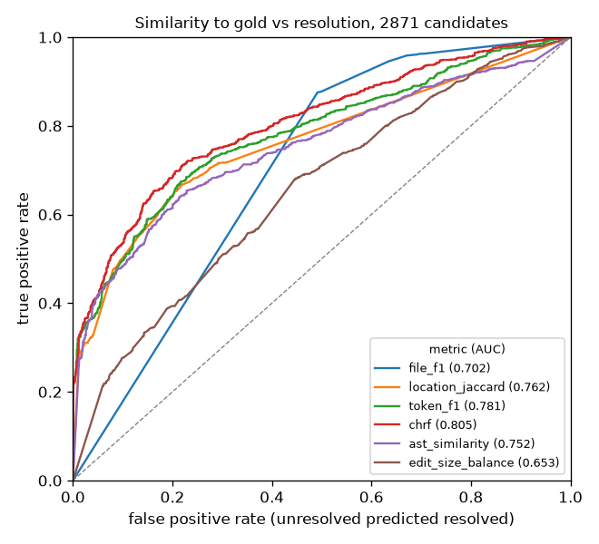

# patchsim

[](https://github.com/vipul21435/patchsim/actions/workflows/ci.yml)

patchsim, by Vipul Raj Jha, scores candidate code patches against the reference (gold) patch at
the file, line, token, character n-gram and Python AST level, and measures how well each score
predicts whether the candidate passes the benchmark tests.

On 2,871 patches from six public SWE-bench Verified submissions, character n-gram F-score (chrF)
separates resolved from unresolved patches best (ROC AUC 0.805, 95 % repository-clustered interval
0.775 to 0.824). The best single cut-off is right for 75.6 % of patches with the threshold chosen on
other repositories, against 57.2 % for always predicting unresolved, so similarity cannot replace
running tests. Details, commands and data licences are under [Results](#results-on-real-public-data).

## Why this is hard

A bug usually has more than one correct fix: a candidate can touch another file or guard the input
at the caller instead of the callee and still pass, while one that differs from the gold patch by a
character can fail. Benchmarks such as SWE-bench (Jimenez et al., ICLR 2024, arXiv 2310.06770)
therefore run tests, and how good similarity is as a proxy depends on the metric and needs an
interval that respects the correlation of instances from the same repository.

## Install

```
pip install git+https://github.com/vipul21435/patchsim
```

Python 3.10 or newer; no runtime dependencies beyond the standard library.

For development, from a clone: `uv venv --python 3.12`, `uv pip install -e .[dev]`, then
`uv run pytest --cov=patchsim` (87 tests, offline, about 3 seconds with coverage; 99 % of
statements covered, every module at 95 % or more).

## Quickstart

The examples are in the repository, not in the installed package, so start from a clone:

```
git clone https://github.com/vipul21435/patchsim && cd patchsim
pip install .
```

From Python, `patchsim.score.score_pair(candidate_diff, gold_diff)` returns every metric for
one pair. `examples/pair.py` scores a hand-made candidate that adds the same guard as the gold
patch in other words and leaves a reproduction script behind:

```
$ python examples/pair.py
all files:
  file_precision: 0.5
  file_recall: 1.0
  file_f1: 0.667
  location_jaccard: 0.5
  token_f1: 0.323
  chrf: 0.393
  ast_similarity: 0.348
  ast_mode: patch_lines
  function_jaccard: 1.0
  same_functions: True
  edit_size_ratio: 2.0
  extra_files: ['reproduce.py']
new files set aside:
  file_precision: 1.0
  file_recall: 1.0
  file_f1: 1.0
  location_jaccard: 1.0
  token_f1: 0.588
  chrf: 0.577
  ast_similarity: 0.533
  ast_mode: patch_lines
  function_jaccard: 1.0
  same_functions: True
  edit_size_ratio: 1.0
  extra_files: []
  dropped_files: ['reproduce.py']
```

`examples/demo.py` writes a toy benchmark (8 gold patches over 3 made-up repositories, 12
candidates from two made-up systems, hand-set outcomes) and runs `patchsim analyze` on it. The
start of its report (the rest lists file-set shares and disagreement examples):

```
$ python examples/demo.py /tmp/patchsim-demo
# patchsim analysis

12 candidates, 7 resolved, 3 repositories; 500 cluster-bootstrap replicates, seed 0.

Empty candidate patches: 0, excluded.
AST mode per candidate: patch_lines 12.

| metric | n | AUC | 95% interval | within-instance AUC | best accuracy (in-sample) | threshold | held-out accuracy | majority |
|---|---|---|---|---|---|---|---|---|
| file_precision | 12 | 0.529 | [0.250, 0.750] | 0.375 [0.250, 0.500] | 0.583 | 1.000 | 0.333 | 0.583 |
| file_recall | 12 | 0.529 | [0.250, 0.750] | 0.375 [0.250, 0.500] | 0.583 | 1.000 | 0.333 | 0.583 |
| file_f1 | 12 | 0.529 | [0.250, 0.750] | 0.375 [0.250, 0.500] | 0.583 | 1.000 | 0.333 | 0.583 |
| location_jaccard | 12 | 0.529 | [0.250, 0.750] | 0.375 [0.250, 0.500] | 0.583 | 1.000 | 0.333 | 0.583 |
| token_f1 | 12 | 0.786 | [0.500, 1.000] | 0.750 [0.500, 1.000] | 0.750 | 1.000 | 0.667 | 0.583 |
| chrf | 12 | 0.743 | [0.500, 1.000] | 0.750 [0.500, 1.000] | 0.750 | 1.000 | 0.750 | 0.583 |
| ast_similarity | 12 | 0.657 | [0.625, 0.750] | 0.875 [0.750, 1.000] | 0.750 | 0.857 | 0.667 | 0.583 |
| function_jaccard | 12 | 0.529 | [0.250, 0.750] | 0.375 [0.250, 0.500] | 0.583 | 1.000 | 0.333 | 0.583 |
| edit_size_balance | 12 | 0.500 | [0.500, 0.500] | 0.500 [0.500, 0.500] | 0.583 | 1.000 | 0.417 | 0.583 |

Within-instance AUC uses only pairs of candidates for the same instance, one resolved and one not (4 instances, 4 pairs for the first metric).

Best accuracy is in-sample: the threshold is chosen and scored on the same candidates. Held-out accuracy chooses it on all repositories but one and scores the one left out, in turn.

...
```

These numbers describe the toy data only. The three subcommands on your own files:

```
patchsim score   --candidates preds.jsonl --gold gold.jsonl --out rows.jsonl
patchsim analyze --candidates preds.jsonl --gold gold.jsonl --outcomes outcomes.jsonl \
                 --n-boot 2000 --json analysis.json --markdown analysis.md
patchsim compare --candidates preds.jsonl --gold gold.jsonl --outcomes outcomes.jsonl \
                 --a system-one --b system-two --markdown compare.md
```

Options shared by all three:

- `--ignore-new-files` sets aside files a candidate creates that the gold patch does not touch
  (reproduction scripts and scratch tests that agents often leave in their final diff); the
  dropped paths are listed per candidate.
- `--sources DIR` gives the pre-patch files of instance `i` at `DIR/i/<path>`; both patches
  are applied to them and the AST metric uses the post-patch source (see below).
- `--include-system NAME` (repeatable) keeps only those systems.

`analyze --vs-metric NAME` adds the paired difference between the AUC of that metric and the
AUC of every other one, each with its interval.

`analyze` leaves empty candidate patches out unless `--keep-empty` is given: an empty patch is
never resolved and scores zero on every metric, so keeping it lifts every AUC with the same
easy cases.

Inputs:

- candidates: JSONL, one object per line with `instance_id`, a system name (`model`, `system`
  or `model_name_or_path`) and a unified diff (`patch`, `model_patch` or `diff`);
- gold: JSONL or a JSON list with `instance_id` and `patch` (the SWE-bench dataset layout);
- outcomes: JSONL with `instance_id`, `resolved` (`true`/`false`, or `0`/`1`; strings are
  rejected) and optionally the system name, or a JSON object with a `resolved` list of
  instance ids, in which case every other scored instance counts as unresolved. Outcomes
  without a system name apply to every system, so they are refused when the candidates come
  from more than one system (keep one with `--include-system`, or name the system per row).

A missing file or directory, a file that is not UTF-8, a malformed line, a row without a
required key, a diff that is not a string, a second row for the same (system, instance) or
the same gold instance, and a `--level` outside (0, 1) all stop the command with a one-line
message naming the file and line or the option, and exit status 2.

## How it works

Diffs are parsed into files and hunks. Original line `n` is position `2n`; the gap after
original line `k`, where a pure insertion lands, is position `2k + 1`. A run of changed lines
between two context lines touches the positions of the lines it removes, or the one gap if it
removes nothing. This keeps insertions comparable with edits without inventing line numbers.
A diff that names the same file in several sections (model-written diffs sometimes do) is read
as one file patch with the hunks of every section, in order of original line.

Per candidate C against gold G:

| metric | formula |
|---|---|
| file precision, recall, F1 | P = \|F(C) ∩ F(G)\| / \|F(C)\|, R = \|F(C) ∩ F(G)\| / \|F(G)\|, F1 = 2PR / (P + R) over the sets of paths |
| location Jaccard | \|L(C) ∩ L(G)\| / \|L(C) ∪ L(G)\| over (path, position) pairs; also reported per file |
| token F1 | 2 \|T(C) ∩ T(G)\| / (\|T(C)\| + \|T(G)\|) over multisets of (side, token), ∩ taking minimum counts |
| chrF | per order n = 1..6, P_n = m_n / \|C_n\|, R_n = m_n / \|G_n\|; P, R their means; (1 + β²)PR / (β²P + R), β = 2 |
| AST similarity | token F1 formula over multisets of Python AST node types |
| function Jaccard | Jaccard of the sets of (path, function name) changed; `same_functions` when equal |
| edit size | ratio = size(C) / size(G); balance = min / max, size = added + removed lines |

Details and the choices behind them:

- Tokens are identifiers, numbers and single non-space characters of the added and removed
  lines; blank lines are dropped, and each token is tagged with its side, so adding `x` never
  matches removing `x`. Whole-line `#` comments are dropped in file types where `#` starts a
  comment (Python, shell, YAML, TOML, INI-style configuration, Ruby, Perl, R, Makefiles and a
  few more; `HASH_COMMENT_SUFFIXES` in `textsim.py`), and kept elsewhere, so C preprocessor
  lines and Markdown headings count. When dropping comments leaves both patches with nothing,
  the comments are compared instead, so two patches that change different comments do not
  both score 1. The same lines feed chrF.
- chrF follows the character n-gram F-score of Popović ("chrF: character n-gram F-score for
  automatic MT evaluation", Tenth Workshop on Statistical Machine Translation, 2015,
  https://aclanthology.org/W15-3049/): precision and recall are averaged arithmetically over
  n-gram orders up to 6, and β gives recall β times the weight of precision. The paper reports
  β = 1 and β = 3; patchsim uses β = 2 (a parameter of `chrf()`), between the two. Here n-grams
  are taken within each changed line with whitespace removed and tagged by side; orders where
  both sides are empty are skipped. Character n-grams give partial credit to `rstrip` against
  `strip`, which token F1 does not. On one changed line per side this equals sacrebleu's
  `CHRF(char_order=6, word_order=0, beta=2)` when both lines have at least six characters
  (sacrebleu 2.6, 283 random pairs, largest difference 0). For a shorter line the orders it
  lacks count as zero here, as in the paper's formula, where sacrebleu's default drops them:
  `ab` against `abcdefgh` scores 0.078 here and 0.234 in sacrebleu.
- AST similarity is a simplified relative of the syntax-match component of CodeBLEU (Ren et al.,
  "CodeBLEU: a Method for Automatic Evaluation of Code Synthesis", arXiv 2009.10297): a multiset
  of node types rather than subtrees, and no data-flow term. Without repository content it works
  on the patch lines (`ast_mode: patch_lines`): the lines are parsed as one dedented block, or
  failing that one by one, with block headers completed by `pass` and unparseable lines (`else:`,
  continuation lines) skipped; node types are tagged by side. With `--sources`, each patch is applied
  to the pre-patch files (`ast_mode: post_patch_source`); node types come from the innermost
  function containing each added line in the post-patch file, tagged `+`, and from the innermost
  function containing each removed line in the pre-patch file, tagged `-`, so a patch that only
  deletes code is still compared by what it deletes. A line outside any function gives the
  innermost statement containing it, looking inside class bodies, so a new class attribute
  counts as one assignment rather than as the whole class; a class header line counts the
  `ClassDef` node with its decorators and bases only. Hunks
  are applied strictly: context and removed lines must match exactly (trailing whitespace
  aside), at the stated line or the nearest offset, with no fuzz. If a file is missing or a
  hunk does not apply, that candidate falls back to `patch_lines`, and the report counts how
  many candidates used each mode. Expression-context nodes (`Load`, `Store`, `Del`) are
  dropped. The metric is None when neither patch touches a `.py` file.
- Changed functions are read from the patch: the nearest `def` line above each changed line
  inside the hunk, or the function named in the hunk header. A later line indented no deeper
  than that `def` (column 0 for a name from the header) ends the function, and changed lines
  outside any function are not counted.

Analysis, for each metric, over candidates with a known outcome:

- ROC AUC = P(s⁺ > s⁻) + ½ P(s⁺ = s⁻), computed from mid-ranks as
  (R⁺ − n⁺(n⁺ + 1)/2) / (n⁺ n⁻); the tests check it against a brute-force count of pairs.
- A percentile bootstrap interval that resamples whole repositories (the part of a SWE-bench id
  before the final `-number`), so that correlated instances from one repository move together.
  Replicates that lose a class are dropped and counted. A simulation test with a random effect
  per repository checks that the bootstrap standard error is within 0.7 to 1.4 times the true
  sampling standard deviation, and that it is wider than an item-level bootstrap.
- Within-instance AUC: the same probability counted only over pairs of candidates for the same
  instance, one resolved and one not, Σᵢ Uᵢ / Σᵢ Pᵢ over instances i, where Pᵢ is the number of
  such pairs and Uᵢ the number in which the resolved candidate scores higher (ties ½). The
  pooled AUC mixes two effects: whether a metric ranks candidates for one task, and whether
  tasks that are easy to resolve also have small, easy-to-match gold patches. The
  within-instance AUC keeps only the first; it needs several systems on the same instances.
  Its interval resamples repositories and sums Uᵢ and Pᵢ over the instances drawn. A test
  checks it against a brute-force count and builds a case where it differs from the pooled AUC.
- The best accuracy of a single rule "resolved when score ≥ t" over all t, against the majority
  baseline max(p, 1 − p). This is in-sample: t is chosen and scored on the same candidates, so
  it is optimistic. The held-out accuracy chooses t on every repository but one, applies it to
  the one left out, and counts correct calls over all repositories in turn.
- The share of resolved candidates touching files outside the gold patch, the share missing a
  gold file, the share of unresolved candidates touching exactly the gold files.
- With `--vs-metric M`, AUC(M) − AUC(m) for every other metric m, over the candidates where
  both are defined; the interval comes from the same repository bootstrap, with both AUCs
  computed on each draw, so the comparison is paired and the shared variation cancels.
- Disagreements, against the best threshold t of one metric (`--example-metric`, default
  chrF): unresolved candidates scoring at least t, and resolved ones scoring below t, with their
  counts and the most extreme examples by instance id (highest first and lowest first); and the
  resolved candidates whose file set differs from the gold patch.

Comparison of two systems A and B (`compare`), on the instances both attempted:

- the mean of each metric for each system and the mean paired difference mean(B − A);
- resolved counts (both, only A, only B, neither) and the difference in resolve rate;
- the AUC within each system and the difference AUC_B − AUC_A, to see whether similarity is a
  better proxy for one system than for the other.

Every interval comes from a bootstrap over repositories in which an instance keeps both of its
candidates, so the two systems are always compared on the same draw (a paired design). A
general `cluster_bootstrap(stat, clusters)` does the resampling; a simulation test checks that
its interval for a mean covers the true value at close to the nominal rate when the data have a
random effect per cluster.

## Results on real public data

Data: the 500 instances of SWE-bench Verified with their gold patches, and the final patches of
six public submissions to its leaderboard, 2,954 candidates in all. Outcomes are the per-instance
resolved lists that the submissions report.

| submission (directory name in the experiments repository) | candidates | resolved |
|---|---|---|
| 20240628_autocoderover-v20240620 | 492 | 192 |
| 20240728_sweagent_gpt4o | 465 | 116 |
| 20241028_agentless-1.5_gpt4o | 500 | 194 |
| 20241029_OpenHands-CodeAct-2.1-sonnet-20241022 | 499 | 265 |
| 20241128_SWE-Fixer_Qwen2.5-7b-retriever_Qwen2.5-72b-editor_20241128 | 500 | 151 |
| 20250225_sweagent_claude-3-7-sonnet | 498 | 312 |

Sources and licences, checked on 2026-11-06:

- Gold patches: princeton-nlp/SWE-bench_Verified, https://huggingface.co/datasets/princeton-nlp/SWE-bench_Verified,
  read through the Hugging Face datasets-server rows API. The dataset card has no licence field
  and states no licence.
- Resolved lists: `evaluation/verified/<submission>/results/results.json` in
  https://github.com/SWE-bench/experiments. The GitHub API reports no licence for the repository
  and its README states none.
- Candidate patches: `all_preds.jsonl` of each submission in the public bucket that the
  submission's `metadata.yaml` names (`s3://swe-bench-submissions/verified/<submission>/`).
- Pre-patch files for the post-patch AST mode: raw.githubusercontent.com at each instance's
  `base_commit`, for every Python file a gold or candidate patch modifies (1,739 files).

Because no licence is stated, this repository commits none of the data: only the fetch script,
the scripts that run the analysis, and the reports in `results/` (summary numbers, system names
and instance ids). The download is about 98 MB (0.9 MB of gold patches, 36 MB of predictions,
61 MB of source files) into `data/` inside the clone (ignored by git; `--out DIR` and the
first argument of `run_real.sh` choose another directory).

Commands (the second runs every analysis below; 1,095 s of wall time, about 18 minutes, on a
laptop, most of it in the paired `--vs-metric` bootstraps):

```
uv run python scripts/fetch_swebench.py --sources
bash scripts/run_real.sh            # writes results/
```

`run_real.sh` calls, among others:

```
D=data
patchsim analyze --candidates $D/candidates.jsonl --gold $D/gold.jsonl --outcomes $D/outcomes.jsonl \
  --n-boot 2000 --seed 0 [--ignore-new-files] [--sources $D/sources] [--vs-metric chrf] \
  --markdown results/....md
```

All six systems pooled; AUC with 95 % repository-clustered bootstrap intervals (2,000
replicates, seed 0); empty patches left out. "All files" scores every file of every candidate
(`results/analysis_all_files.md`, 2,929 candidates); "new files set aside" adds
`--ignore-new-files` (`results/analysis_ignore_new.md`, 2,871 candidates: 58 more become empty
because they only created files, all of them unresolved). The two accuracy columns are for
the second setting, against a majority baseline of 0.572 (predict every candidate unresolved).
Best accuracy is in-sample (the threshold is chosen on the same candidates); held-out accuracy
chooses it on 11 repositories and scores the twelfth, for each repository in turn.

| metric | AUC, all files | AUC, new files set aside | within-instance AUC, new files set aside | best accuracy (in-sample) | held-out accuracy |
|---|---|---|---|---|---|
| file_precision | 0.657 [0.611, 0.687] | 0.646 [0.614, 0.686] | 0.615 [0.571, 0.680] | 0.600 | 0.565 |
| file_recall | 0.700 [0.655, 0.720] | 0.690 [0.652, 0.715] | 0.613 [0.581, 0.642] | 0.653 | 0.653 |
| file_f1 | 0.702 [0.657, 0.733] | 0.702 [0.665, 0.744] | 0.624 [0.577, 0.687] | 0.666 | 0.666 |
| location_jaccard | 0.762 [0.724, 0.776] | 0.762 [0.726, 0.778] | 0.737 [0.698, 0.778] | 0.734 | 0.723 |
| token_f1 | 0.731 [0.695, 0.741] | 0.781 [0.747, 0.800] | 0.740 [0.694, 0.787] | 0.739 | 0.732 |
| chrf | 0.779 [0.748, 0.790] | 0.805 [0.775, 0.824] | 0.768 [0.724, 0.819] | 0.759 | 0.756 |
| ast_similarity (patch lines) | 0.703 [0.654, 0.719] | 0.752 [0.696, 0.777] | 0.705 [0.645, 0.750] | 0.727 | 0.715 |
| ast_similarity (post-patch source) | - | 0.791 [0.772, 0.806] | 0.720 [0.655, 0.765] | 0.742 | 0.732 |
| function_jaccard | 0.620 [0.583, 0.705] | 0.616 [0.577, 0.706] | 0.605 [0.569, 0.650] | 0.649 | 0.648 |
| edit_size_balance | 0.617 [0.581, 0.629] | 0.653 [0.627, 0.672] | 0.579 [0.538, 0.631] | 0.634 | 0.630 |

The post-patch row is from `results/analysis_post_patch.md` (`--ignore-new-files --sources`);
2,862 of its 2,871 candidates used the post-patch source and 9 fell back to patch lines. The
within-instance AUC uses 1,912 resolved/unresolved pairs from 295 instances.



`results/roc.png`: ROC curves for the "new files set aside" setting, AST on patch lines,
drawn by `scripts/plot_roc.py` with matplotlib (Agg).

File sets (from the same two reports):

| share | all files | new files set aside |
|---|---|---|
| resolved candidates touching a file outside the gold patch | 296 of 1,230 (0.241) | 125 of 1,230 (0.102) |
| resolved candidates missing a gold file | 80 of 1,230 (0.065) | 80 of 1,230 (0.065) |
| unresolved candidates touching exactly the gold files | 674 of 1,699 (0.397) | 807 of 1,641 (0.492) |

Per system, new files set aside: AUC with 95 % interval for each metric (`results/systems.md`;
one candidate per instance, so no within-instance AUC):

| system | n | resolved | AUC, file_f1 | AUC, location_jaccard | AUC, token_f1 | AUC, chrf | AUC, ast_similarity |
|---|---|---|---|---|---|---|---|
| 20240628_autocoderover-v20240620 | 492 | 192 | 0.704 [0.630, 0.733] | 0.764 [0.685, 0.788] | 0.768 [0.669, 0.822] | 0.788 [0.694, 0.838] | 0.745 [0.625, 0.807] |
| 20240728_sweagent_gpt4o | 398 | 116 | 0.691 [0.599, 0.815] | 0.774 [0.709, 0.813] | 0.749 [0.707, 0.842] | 0.785 [0.750, 0.831] | 0.718 [0.673, 0.768] |
| 20241028_agentless-1.5_gpt4o | 496 | 194 | 0.717 [0.687, 0.767] | 0.757 [0.721, 0.802] | 0.797 [0.750, 0.822] | 0.805 [0.765, 0.832] | 0.775 [0.716, 0.805] |
| 20241029_OpenHands-CodeAct-2.1-sonnet-20241022 | 490 | 265 | 0.699 [0.657, 0.741] | 0.760 [0.704, 0.786] | 0.766 [0.706, 0.791] | 0.788 [0.754, 0.813] | 0.734 [0.678, 0.754] |
| 20241128_SWE-Fixer_Qwen2.5-7b-retriever_Qwen2.5-72b-editor_20241128 | 500 | 151 | 0.723 [0.691, 0.793] | 0.747 [0.671, 0.815] | 0.820 [0.762, 0.873] | 0.837 [0.797, 0.888] | 0.787 [0.704, 0.827] |
| 20250225_sweagent_claude-3-7-sonnet | 495 | 312 | 0.664 [0.609, 0.685] | 0.737 [0.700, 0.772] | 0.759 [0.714, 0.800] | 0.791 [0.746, 0.818] | 0.733 [0.671, 0.766] |

Two systems with the same agent scaffold and different models (`results/compare_sweagent.md`,
`patchsim compare ... --ignore-new-files --a 20240728_sweagent_gpt4o --b
20250225_sweagent_claude-3-7-sonnet`): on 463 shared instances B resolved 293 and A 116 (both
110, only A 6, only B 183), and B's patches are closer to gold on every metric (chrF mean 0.520
against 0.313, difference 0.207 [0.130, 0.239]). The AUC of chrF is the same for both (0.786
and 0.794, difference 0.008 [−0.073, 0.047]): the more capable system writes patches more like
the gold patch, but similarity is no better a proxy for its correctness.

What the numbers say:

- Character n-grams (chrF) separate resolved from unresolved candidates best of the metrics
  that read the patch alone, at AUC 0.805 pooled and 0.768 within an instance. The paired
  differences (`--vs-metric chrf`, in `results/analysis_ignore_new.md`) exclude zero against
  each of them: chrF minus token F1 0.024 [0.011, 0.037], minus location Jaccard 0.043
  [0.025, 0.063], minus AST on patch lines 0.053 [0.038, 0.089], minus file F1 0.103
  [0.057, 0.130]. Against the AST metric on post-patch source the difference is 0.014
  [−0.007, 0.024] (`results/analysis_post_patch.md`), so the two cannot be told apart here.
- Best-threshold accuracy for chrF is 0.759 in-sample and 0.756 with the threshold chosen on
  the other repositories, against a majority baseline of 0.572: about one candidate in four is
  misclassified by the best single cut-off, which is far from a substitute for running tests.
  With chrF at its best threshold (0.472), 265 unresolved candidates score at or above it and 427
  resolved ones below it.
- File-level agreement is a weak proxy: within an instance its AUC is 0.62. Nearly half of the
  unresolved candidates (0.492) edit exactly the gold files, and 10 % of resolved ones edit some
  other file even after created files are set aside.
- Agents leave reproduction scripts and scratch tests in their final diffs. Counting them
  doubles the share of resolved candidates "outside the gold files" (0.241 against 0.102) and
  costs the token and AST metrics 0.05 of AUC.
- Every pooled AUC is higher than its within-instance counterpart, by 0.01 to 0.08: part of the
  pooled signal is that easy tasks have small gold patches that are easy to match.
- With 12 repositories, and Django holding 231 of the 500 instances, the repository-clustered
  intervals are wide and often asymmetric around the point estimate; they are honest about how
  few independent repositories there are, not a sign of an error.
- Disagreement examples worth reading (from `results/analysis_ignore_new.md`):
  psf__requests-1766 from 20240628_autocoderover-v20240620 makes the same one-line change as the
  gold patch (chrF 1.000; the gold patch also strips whitespace on a blank line) and is recorded
  unresolved, so the outcome rather than the metric deserves a second look; patchsim does not
  rerun tests. sympy__sympy-22456 is resolved by two systems with chrF 0.015, a different fix
  from the gold patch.

## Limitations

- Not implemented: rerunning tests (outcomes are taken as given, including any flaky or
  mislabelled ones); a data-flow term or subtree matching in the AST metric (CodeBLEU has
  both); several gold patches per instance; non-Python AST metrics (other languages get the
  file, location, token and chrF metrics only); fuzzy hunk application.
- Function detection from the patch is a heuristic: nested functions and methods with the same
  name in different classes are not resolved, and a multi-line string at column 0 inside a
  function ends it early.
- The AST metric compares counts of node types and ignores identifiers and position: the same
  kind of edit made in another function (`return 1` to `return 10` in `f` against `return 2`
  to `return 20` in `g`) scores 1.0. Read it next to location Jaccard and function Jaccard.
- Location overlap compares positions in the original file only; two patches that insert the
  same code one line apart share nothing.
- Similarity is measured against one gold patch; an instance with several valid fixes penalises
  every fix but the one recorded.
- `--ignore-new-files` drops every file a candidate creates outside the gold paths, including a
  new module that a correct fix needs; the dropped paths are listed so this can be checked.
- The real-data results cover six submissions from 2024 and early 2025 on one benchmark of 12
  Python repositories; they say nothing about other benchmarks, languages or newer systems.
  The repository-clustered bootstrap has only 12 clusters, and the percentile interval is
  known to run short with few clusters (the simulation test allows coverage down to 0.85).
- The pooled analysis treats each candidate as one observation; candidates for the same
  instance are correlated through the instance as well as the repository, which the
  repository-level resampling covers but does not model.

## Related work and tools

Public work:

- SWE-bench (Jimenez et al., "SWE-bench: Can Language Models Resolve Real-World GitHub
  Issues?", arXiv 2310.06770, https://arxiv.org/abs/2310.06770) defines the task, the gold
  patches and the test-based resolution that this tool treats as ground truth.
- chrF (Popović, 2015, https://aclanthology.org/W15-3049/) is the character n-gram F-score the
  `chrf` metric follows.
- CodeBLEU (Ren et al., "CodeBLEU: a Method for Automatic Evaluation of Code Synthesis", arXiv
  2009.10297, https://arxiv.org/abs/2009.10297) adds syntax and data-flow matches to n-gram
  overlap; the AST metric here is a reduced form of its syntax term.
- Smith, Barr, Le Goues and Brun, "Is the cure worse than the disease? Overfitting in automated
  program repair" (ESEC/FSE 2015, https://doi.org/10.1145/2786805.2786825) evaluate repair
  tools with tests independent of the ones used during repair and find patches that pass the
  repair tests while breaking untested behaviour. Here the test outcome is the label, so a
  resolved candidate that differs from the gold patch may be a different correct fix or one that
  overfits the tests; patchsim cannot tell them apart.

Sibling tools by the same author:

- [evalstats](https://github.com/vipul21435/evalstats): intervals and paired tests for evaluation results.
- [patchmin](https://github.com/vipul21435/patchmin): the minimal subset of a patch that still fixes the tests.
- [issuelint](https://github.com/vipul21435/issuelint): checks issue text for leakage of the solution.
- [reporewind](https://github.com/vipul21435/reporewind): resolves Python fix commits into source and test patches.
- [trajlens](https://github.com/vipul21435/trajlens): reads coding-agent trajectories, the runs that produce candidate patches like these.
- [contamscan](https://github.com/vipul21435/contamscan): measures contamination of a training corpus with benchmarks such as SWE-bench.
- [awesome-coding-agent-evals](https://github.com/vipul21435/awesome-coding-agent-evals): a list of benchmarks, harnesses and datasets for evaluating coding agents.

## Licence

MIT, see [LICENSE](LICENSE).

Built by Vipul Raj Jha · https://vipul21435.github.io
